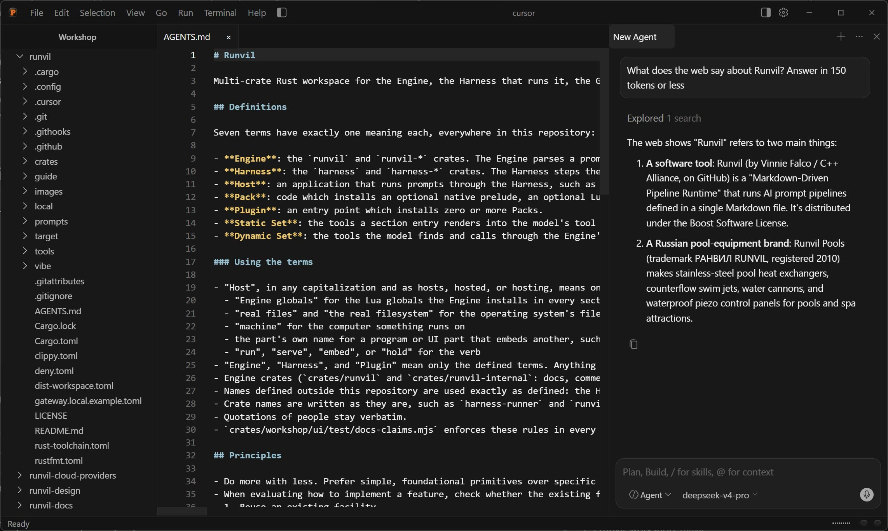

[](https://github.com/cppalliance/runvil-workshop/actions/workflows/ci.yml)
[](LICENSE)

# Runvil Workshop

Workshop is the desktop app for [Runvil](https://github.com/cppalliance/runvil). You open your folders in it, edit files, and work with agents in the chat panel beside the editor. Every agent is a Runvil prompt: the built-in chat agent is one, and any prompt you put in your agents folder shows up next to it. Workshop records each run in a local log that only ever grows.



The [Workshop guide](https://runvil.org/workshop/) explains how to use it.

## Install

The installers are built and released in [cppalliance/runvil](https://github.com/cppalliance/runvil), and its README links one for each platform. An installer offers Workshop and the Gateway, and an installed Workshop offers each new version when it starts.

## Build from source

You need the Rust toolchain that `rust-toolchain.toml` names and Node.js 22. Linux also needs Tauri's system packages: `libwebkit2gtk-4.1-dev`, `libssl-dev`, and `librsvg2-dev`.

```text
npm ci --prefix crates/workshop
node tools/fetch-gateway-sidecar.mjs --target <triple>
cargo workshop
```

- `npm ci` installs the UI's dependencies and the pinned Tauri CLI.
- The fetch script downloads the Gateway release that `gateway-pin/pin.json` names, checks its SHA-256, and stages it for every later build. `<triple>` is your machine's target triple, which `rustc -vV` prints as `host`.
- `cargo workshop` builds Workshop as `target/debug/runvil-workshop`, and places the Gateway and the Plugins' libraries beside it.

`cargo workshop bundle` builds one platform's Tauri bundle in release. The installers in `cppalliance/runvil` are built from that bundle. [crates/build-workshop/README.md](crates/build-workshop/README.md) describes both commands.

## What this workspace pins

Workshop is a Host: it runs prompts through the Harness and makes every policy decision. The code it runs on is in other repositories, and this workspace pins each one:

| Code | Repository | Pinned by |
|---|---|---|
| The Engine, the Harness, and the web and mcp Plugins | [cppalliance/runvil-harness](https://github.com/cppalliance/runvil-harness) | commit, in the root `Cargo.toml` |
| The C Plugin contract | [cppalliance/runvil-plugin-api](https://github.com/cppalliance/runvil-plugin-api) | commit, in the root `Cargo.toml` |
| The std Plugin, which holds the file tools | [cppalliance/runvil-plugin-std](https://github.com/cppalliance/runvil-plugin-std) | commit, in the root `Cargo.toml` |
| The bashkit Plugin, which holds the shell | [cppalliance/runvil-plugin-bashkit](https://github.com/cppalliance/runvil-plugin-bashkit) | commit, in the root `Cargo.toml` |
| The Gateway | [cppalliance/runvil-gateway](https://github.com/cppalliance/runvil-gateway) | release, in `gateway-pin/pin.json` |

## Contributing

Pull requests are welcome, and every change must pass the formatting, lint, and test checks that CI runs. [AGENTS.md](AGENTS.md) explains the project's terms and conventions and how to run those checks locally.

## License

Runvil Workshop is distributed under the [Boost Software License 1.0](LICENSE).
