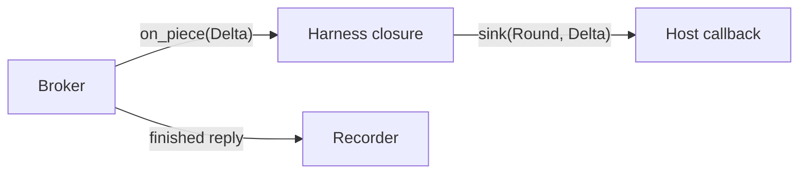

# Stream a reply's pieces to the Host through `on_piece` and `RunSetup::streaming`

A broker hands each live piece of a model reply to a callback, and a Host turns that on for one run. This plan builds sections 5 and 10 of [runvil-design/research/2026-11-24-inference-broker-streaming-design.md](runvil-design/research/2026-11-24-inference-broker-streaming-design.md) as they stand. The work is two code commits in `runvil-harness`, one in `runvil-workshop`, and one page commit in `runvil-design`. Each code commit holds the tests of its change. It closes issue [#74](https://github.com/cppalliance/runvil-harness/issues/74).

## For the agent that runs this plan

This section is for an agent that starts with this file alone. What the run needs is in this file, in the three repos, and in the files named here. In this file, "I" is that agent, and "you" is the owner of the repos, who approved the plan.

### Read first

1. Sections 5, 6, and 10 of the design doc linked above. They are the design, and this plan is how it gets built.
2. [runvil-harness/AGENTS.md](runvil-harness/AGENTS.md) and [runvil-workshop/AGENTS.md](runvil-workshop/AGENTS.md): the terms, the rules, and the verification list of each repo. Where this plan and they differ, they are right.
3. [.cursor/rules/commit.mdc](.cursor/rules/commit.mdc): how a commit message is written, from the staged diff alone.
4. The sections "How this machine behaves" and "Checks that refuse things you might write" of [runvil-harness/plan/2026-11-21-1-host-builder-and-run-timer.plan.md](runvil-harness/plan/2026-11-21-1-host-builder-and-run-timer.plan.md).
5. The part of [runvil-harness/plan/2026-11-21-2-run-services-and-event-values.plan.md](runvil-harness/plan/2026-11-21-2-run-services-and-event-values.plan.md) from the heading `# What the build found`. It is the form of the record.
6. Sections 3, 4, 6, 10, and 11 of [tools-public/rulebooks/rust-rulebook.md](tools-public/rulebooks/rust-rulebook.md): idioms, ownership, API design, docs, and tests. The section "Rust rules this work follows" below says how they apply here.

The conversation behind this plan is the chat [Streaming design and plan](9f59b330-031c-442c-aa32-49d5c8b55eae). Its transcript can be searched for a detail that this file leaves out.

### The short names this plan uses

- **The Harness** is the repo `runvil-harness`. **Workshop** is the repo `runvil-workshop`, a Host application. **The design repo** is `runvil-design`.
- **The runner** is the crate `harness-runner` in `crates/harness-internal/runner`. It holds `RunSetup`, the effect loop, and the broker trait `InferenceBroker`.
- **The facade** is the crate `runvil` in `crates/runvil`, the one crate that a Host depends on. It re-exports what the other crates define.
- **The Gateway client** is the crate `harness-gateway-client`. It holds `GatewayBroker`, the standard broker.
- **The listing** is `crates/runvil/public-api.txt`, the recorded public API of the facade, which a check compares with the code. To bless it is to rewrite it from the code.
- **The pages** are the decision pages in `runvil-harness/decisions/`. Each entry is a heading with the rule and its reason.
- **The runner's suites** are the tests in `crates/harness-internal/runner/tests/it/`, and **the facade suite** is `crates/runvil/tests/suite/`.
- **A piece** is one live fragment of a model reply, answer text or reasoning text. Its type is `Delta`. **A round** is one model request and its reply. A round's origin is `Chat` for a section's own round, which `models.loop` runs, and `Infer` for a nested `models.infer`.

### Where things are

- **The repos** are checkouts in the workspace root, `c:\Users\Vinnie\cursor`. In the Harness and in Workshop, `origin` is the fork under `vinniefalco` and `upstream` is the repo under `cppalliance`. In the design repo, `origin` is the repo under `cppalliance`, and it is the one remote. Your fork of it is `vinniefalco/runvil-design`, whose `master` is an ancestor of the local one, and I push to it by its URL, `git push git@github.com:vinniefalco/runvil-design.git master`. The one branch of each repo is `master`, and the work stays on it.
- **This plan** is the file `C:\Users\Vinnie\.cursor\plans\streaming_callback_refactor_93d3a6c9.plan.md`. Each repo's copy is made from it, under one file name in all three repos.
- **The scratch folder of this run** is `cabinet/_scratch/streaming-callback/`. It holds the three scripts, `notes.md`, each commit message, and the patch file of the dry run. The notes hold the three heads from prep, each test count, and each result on the way.

### Rules of this work

The workspace rules apply. These come from your requests:

- **This file stays as it is during the run.** Results go into the notes, into the record in the Harness copy, and into the chat.
- **Each repo that takes a commit gets a copy of the plan as its first commit,** and every commit of that repo ends with `Plan: /plan/<file>`.
- **Each commit that changes code holds the tests of that change.** A commit without a test is one without code: a plan copy, the record, the design pages, or a move of Workshop's pin alone.
- **The work is three code commits,** two in the Harness and one in Workshop. That is few enough to review and enough to keep the broker side, the Host side, and Workshop apart.
- **Each code commit passes the whole verification list of its repo before it is committed,** and each is one commit on `master`.
- **Everything is pushed to your forks, and each repo gets a pull request:** the Harness, Workshop, and the design repo.
- **Nothing merges before GitHub Actions is green.** I wait for it. The merges go in the order of the pins: the Harness, then Workshop, then the design repo.
- **Whatever this work breaks is fixed in this work:** a caller, a test, a doc link, or a check on a pull request.
- **Workshop is committed only with its pin on a Harness commit.** The `[patch]` section of the dry run stays out of every commit.
- **Every caller but the classroom is fixed.** `runvil-classroom` stays as it is.
- **Docs and pages say how the code is.** A doc comment, a page entry, a README, and a test's message describe the code as it stands after the commit that holds them. They leave out how it was and how it changed: words such as "now", "no longer", "used to", "new", "replaces", and "was removed", and the names `chat_streaming` and `RunBroker`. A commit message, a pull request body, and the record are where a change is described.
- **A workspace file is never deleted.** It is moved to `cabinet/_trash/`.
- **A question to you is a choice between concrete options.** A small point is settled with a stated confidence level.
- **Each report to you gives the facts before the finding,** in plain conversational English, with a dash where an em dash would go.
- **You read Rust as a C++ expert who is new to Rust.** A report says what a Rust form does in plain words.

### Decisions that are made

These were settled in the conversation. I build them as they are, and I stop and tell you if the code makes one impossible.

- **A callback, and no stream.** Section 10 of the design doc has the reasons.
- **The latch is out.** The Host's callback returns nothing. The Harness passes every piece on, and it neither buffers nor skips one.
- **The Host owns any queue.** A Host that lags stops taking pieces in its own code, and the finished reply fills in the rest.
- **The callback returns at once and never calls into the Harness.** The docs say so outright. The Harness gets no code that supports a call from inside the callback.
- **`supports_streaming` is a required method,** and a hint for a Host's display.
- **#75 is a reference.** The code is written fresh, the pull request names #75, and the last commit closes #74 and #75.
- **The merges are approved.** Each one waits for green GitHub Actions and goes in the order of the pins.
- **Every caller is fixed but the classroom,** and every doc and page describes the code as it is.
- **Dated records stay as written:** the files under `plan/`, `vibe/`, and `research/`. The streaming design doc gains the callback's rule and nothing else.
- **`seq` on `agent_delta` and the classroom are outside this plan.**

### How this machine behaves

The machine runs Windows with PowerShell 5.1. The earlier plan's section has the full list, and these are the points this run needs:

- **`gh` with `--jq`:** the expression goes in single quotes and is written without a double quote inside it.
- **`git` and `cargo` write progress to stderr,** which PowerShell shows as an error record. The exit code is what counts.
- **A file written from PowerShell** goes through `[System.IO.File]::WriteAllText(path, text, (New-Object System.Text.UTF8Encoding($false)))`, because `Set-Content -Encoding UTF8` adds a byte order mark.
- **A commit message** is saved as a file in the scratch folder and committed with `git commit -F <file>`.
- **A patch** is saved with `git diff --output=<file> -- <paths>`, so that PowerShell's redirection cannot change its encoding.
- **The listing** is checked and blessed with the toolchain `nightly-2026-09-05`, while `CARGO_BUILD_WARNINGS` is unset.
- **After a manifest changes,** `cargo fetch` refreshes `Cargo.lock`. `cargo fmt --all` runs before each verification. A line that it changes outside this work's edits goes into the record with its reason. #75 holds two such lines, in the block comments of the facade's `lib.rs`.
- **A push runs a pre-push hook** in each repo, so a push takes a while.

## What changes for a Host

```rust
// runner: performers.rs
pub type PieceSink = Arc<dyn Fn(Delta) + Send + Sync>;
#[derive(Debug, Clone, PartialEq, Eq)]
#[non_exhaustive]
pub enum Delta { Text(String), Reasoning(String) }

pub trait InferenceBroker: Send + Sync {
    fn models(&self) -> BoxFuture<'static, Result<ModelCatalog, Error>>;
    fn supports_streaming(&self) -> bool;              // new, required
    fn chat(&self, binding: ModelBinding, messages: Vec<Message>, tools: Vec<ToolSchema>,
            options: CompletionOptions, round: Round,
            on_piece: Option<PieceSink>,               // new
    ) -> BoxFuture<'static, Result<Box<Completion>, Error>>;
}

// runner: setup.rs
pub type HostSink = Arc<dyn Fn(Round, Delta) + Send + Sync>;
impl RunSetup {
    #[must_use]
    pub fn streaming(mut self, sink: impl Fn(Round, Delta) + Send + Sync + 'static) -> RunSetup;
}
```



## The rules of the Host's callback, which the docs state outright

The Harness calls the callback from inside the future that drives the run, in the middle of a round. The docs of `RunSetup::streaming`, of `HostSink`, and of the `streaming` field say all three rules in these terms:

- **It returns at once.** It never waits, sleeps, or blocks.
- **It never calls into the Harness.** The Harness is not reentrant. The callback must not call `RunControl::send`, `RunControl::stop_round`, or `RunControl::cancel`, and it must not start, poll, or drop a run. The Harness promises nothing about the result of such a call.
- **A Host that reacts to a piece does so from its own code.** The callback hands the piece to a channel, a flag, or a broadcast and returns. The Host's own task then stops the round or cancels the run, from outside the callback.

What the code does today, read on 2026-11-24: the three `RunControl` calls set a flag or queue a message and wake the loop, so from inside the callback they would act at the loop's next wait, and a `send` would withdraw the round that is streaming. No test covers that path, and the docs make it off limits. The loop gets no change that makes such a call work.

## Rust rules this work follows

These come from the Rust rulebook. Where it and a repo's `AGENTS.md` differ, `AGENTS.md` wins. That covers three points: the Harness reports every failure as the universal `Error`, it bans a compiled code block in a doc comment, and each repo keeps its lint levels where it has them. This work adds no error type.

### Lend, and clone only for a second owner

The owner of a value lends it down the call tree. A clone is written only where a second owner has to exist, and a comment beside it names that owner. A clone whose one effect is to make a borrow error go away is a defect. I name the two borrows that overlap and restructure: end the first borrow sooner, reorder so that the move is the last use, or lend from the owner.

The clones this work adds, each for a second owner:

- **The Harness, in `perform`:** `Arc::clone(host)`, once for each `Chat` round. The round's future is `'static`, so its callback owns a handle to the Host's callback.
- **Workshop, in `setup_for`:** `conversation.clone()`. The callback is `'static`, and the caller still needs the conversation to run the run. `self.inner.broker.clone()` is there today and stays: `WorkshopBroker` is a handle, and the setup owns one.
- **Test support:** `ScriptedBroker` copies its pieces for a round that was handed a callback, because the callback takes each piece by value and the broker keeps its list for the next round. A test also keeps a handle, `Arc::clone(&kept)`, to read what a callback recorded after the callback moved into a setup.

Everything else moves or is lent:

- **The setup lends the Host's callback to the loop.** `drive` passes `setup.streaming.as_ref()`, and `Driver::drive` and `perform` take `Option<&HostSink>`. The loop makes no copy for the run.
- **A piece moves from the transport to the Host.** `StreamDelta::Text(text)` becomes `Delta::Text(text)`, the closure hands it to the Host's callback, and Workshop's callback moves the text into `publish_delta`.
- **`on_piece` moves** from `chat` into the round's future, and through a wrapper broker into the broker it wraps.
- **`Round` is `Copy`,** so each closure holds it by value.
- **A test broker that builds its reply from the pieces** pushes each piece onto the reply first and then moves it into the callback.

**The clone audit.** Before each code commit, I search the lines the commit adds for `.clone()`, `Arc::clone`, `to_owned()`, `to_vec()`, and `to_string()`. Each hit is on the list above or gets a comment that names its second owner, and the record lists them.

### The other rules that apply

- **Spelling:** `Arc::clone(&x)` for an `Arc`, and `.clone()` for a handle struct such as `Conversation`. A borrowed option is `Option<&T>`.
- **Matches:** a `match` on an enum of the same crate lists every variant, as the Gateway broker does on `StreamDelta`. A catch-all arm is for a `#[non_exhaustive]` enum of another crate: `Delta` in Workshop, and `ReplyOrigin` in the runner.
- **The new API:** `Delta` is `#[non_exhaustive]` and derives `Debug`, `Clone`, `PartialEq`, and `Eq`. The setter is `#[must_use]`, and it takes its callback by value with a `'static` bound because it stores it. The trait stays at three methods and stays usable as `dyn InferenceBroker`.
- **Docs:** every public item has a doc comment whose first line is one sentence in the third person, such as "Turns streaming on for the run." An example in a doc comment is a `text` fence.
- **Lints:** a suppression is `#[expect(lint, reason = "..")]`, and the record names it. `#[allow]` stays out.
- **Tests:** each test is in the commit of the code it tests. A unit test is at the bottom of the file under test, and what a test imports is imported inside its test module.
- **Panics and locks:** code outside tests is written without `unwrap`. A lock guard is released before any `.await`, which the synchronous callbacks keep true by their form.

## Where this starts

Read on 2026-11-24 at about 19:55 PST. Line numbers in this plan are from these local heads.

- **`runvil-harness`:** local `master` is `22a0992f`. Upstream is `6df50aba`, six commits ahead, all on prompt annotations. They leave the runner, the Gateway client, and the two pages at the same line numbers, and they move the lines of the listing by a few. The fork is `ee89d088`.
- **`runvil-workshop`:** local `master` and the fork are `f40a4fce`. Upstream is `3c12833c`, two commits ahead (version 0.3.1 and lock updates). It pins the Harness at `ee89d088`.
- **`runvil-design`:** local `master` and the remote are `85bcf91`. Your fork is at `7494105`, 17 commits behind, so a push to it is a fast-forward.
- **All three trees are clean.**
- **Issue #74** is open and unassigned. Its four criteria match this plan: the Host's callback returns `()`, and the Harness forwards every piece. It calls the Workshop cutover a follow-up, and this plan includes it.
- **Pull request [#75](https://github.com/cppalliance/runvil-harness/pull/75)** built the Harness half of #74. Its author closed it unmerged on 2026-11-24 at 19:07 PST. The next section says what this plan uses of it.
- **Brokers:** the Harness holds 10 `impl InferenceBroker` in 9 files (`OfflineBroker`, `GatewayBroker`, 8 test brokers). Workshop holds 2, both in `agents/broker.rs`.
- **Callers in the workspace:** a search of all 19 repos under the workspace root finds code that names the trait in three: the Harness, Workshop, and `runvil-classroom`. `runvil` and `runvil-gateway` name it only in dated records under `plan/` and `vibe/`. The guide, `runvil-docs`, describes neither a broker nor how a Host streams.
- **Other open pull requests:** only Harness [#27](https://github.com/cppalliance/runvil-harness/pull/27) holds brokers. It needs the new parameter and method when it rebases.
- **Scripts:** the scratch folder of the earlier plans is gone, so the three scripts are rebuilt.

## What pull request #75 settles, and what this plan leaves out of it

#75 is the branch `feat/74` of the fork `justinwilaby/runvil-harness`, three commits ending at `098f6b4f`, on the base `6df50aba`. `gh pr diff 75 --repo cppalliance/runvil-harness` shows it. All 11 of its checks were green, `ci-green` among them.

- **Its interface is this plan's interface.** The names, the trait signature, the `streaming` field, the setter, and the exports are the same, so its green checks settle four points that this plan could only read from the code:
  - The listing check accepts `PieceSink` in a trait signature and `HostSink` in a field.
  - Clippy accepts `chat` with seven inputs, which is its limit.
  - The structural checks and the custom lints accept the effect loop handing `perform` the Host's callback as an argument.
  - The lines that the listing gains are known. Each commit below lists its own.
- **I write the code fresh and read #75 as a reference** for the parts that match: `performers.rs`, `setup.rs`, the two export files, `GatewayBroker`, and the nine brokers.
- **This plan leaves these parts of #75 out:**
  - **Its changes to the effect loop,** about 180 lines that make a stop or a cancel raised from inside the callback win over a reply that is ready in the same poll. You decided that the callback never calls into the Harness, so the loop needs none of it.
  - **Its tests of that path:** a cancel and a stop from the callback, and the tests of the message drain.
  - **Its new facade test file of 1,128 lines and the `axum` dev-dependency it needs.** Seven tests in files that exist cover #74's criteria.
  - **Its entry in `testing-and-debugging.md`,** which describes tests. The Harness's `AGENTS.md` keeps test names and counts out of an entry.
  - **Its copy of the Host's callback for each run.** #75 calls `driver.drive(setup.streaming.clone())`. The setup outlives the drive, so this plan lends the callback with `setup.streaming.as_ref()`.
- **The Harness pull request names #75** and says that its interface is the same. The last commit of the pull request, the record, has the lines `close #74` and `close #75`. #75 is closed already, so its line links the commit to it.

## The commits, and the tests each one holds

Three commits change code, and each holds the tests of its change. The other five hold text alone.

- **Harness commit 0:** the plan copy. Text.
- **Harness commit 1, the broker side:** the trait, every broker, and the Gateway broker's forwarding. Its tests: the Gateway broker's three round tests on the new call, a new test that a callback which keeps one piece still leaves the whole reply, and a new test that `OfflineBroker` says it does not stream.
- **Harness commit 2, the Host side:** `RunSetup::streaming` and the closure in the effect loop. Its tests: seven new ones, in the runner and in the facade suite, and the facade's `Streaming` test on the new setter.
- **Harness commit 3:** the record. Text. It closes #74 and #75.
- **Workshop commit 0:** the plan copy. Text.
- **Workshop commit 1, the pin and the cutover:** its tests are a new test of `live_pieces` and the broker tests on the new call. The socket tests, which stay as they are, show the whole path.
- **Design commit 0:** the plan copy. Text.
- **Design commit 1:** the decision pages and the rule in the design doc. Text.

A ninth commit exists only if today's Harness breaks Workshop: the pin on today's head, the fix, and a test of the fix. A commit after a review holds a test when it changes code. A commit that only moves Workshop's pin, or only an id on a design page, holds neither code nor a test.

## How the work is delivered

1. **Prep.** Check that all three trees are clean. Fast-forward the Harness and Workshop to upstream (`git fetch upstream`, then `git merge --ff-only upstream/master`), and the design repo to `origin` the same way. Note the three heads: each merge checks its repo against its own, and Workshop's check in step 4 pins the Harness's. If an upstream head has moved past the ones under Where this starts, read what changed in the runner and the Gateway client and count the brokers again. Confirm that the Harness still pins `runvil-plugin-sys` at the commit where Workshop pins `runvil-plugin-sdk` (`74f9e08b` in both today). Rebuild the three scripts, described under Verification and commit messages. Run `verify.ps1` once for the Harness's base test count. Workshop's base is the run of its check in step 4. Post the comment below on #74 and assign the issue to you.
2. **Harness commit 0:** the plan copy alone, as `runvil-harness/plan/<date>-<n>-streaming-callback.plan.md`, with the date of that day and the next free number. The copy is this file with every todo `pending`. Its subject has the form "Add the plan for ..".
3. **Harness commits 1 and 2,** each after `verify.ps1` shows `exit=0` on every line and the expected count, and after the clone audit. Commit 2 also waits for the sweep's searches to come back clean on the Harness tree, so that a leftover is fixed inside the commit.
4. **Workshop commit 0 and the check on today's Harness.** Commit 0 is the plan copy. The check sets the three `rev` values to the Harness head from prep and runs Workshop's whole list, to learn whether the 20 Harness commits since Workshop's pin break it. A green check ends with `git restore .` and no commit. Both need only that head and the file name of the Harness copy, so I make the edits while step 3 verifies.
5. **Workshop dry run** of the cutover, on the tree as step 4 left it, under a temporary `[patch]` on the local Harness. I write the edits while Harness commit 2 verifies. The sweep's searches run on the edited tree, and a leftover is fixed there. Then the code edits are saved as a patch file, without `Cargo.toml` and `Cargo.lock`, and the tree is restored with `git restore .`. The cutover adds no file, so the patch and the restore cover all of it.
6. **Harness commit 3:** the record, "What the build found", in the Harness copy of the plan, with the todo statuses. It covers Harness commits 1 and 2, Workshop's check on today's Harness, and the dry run. It is the last commit of the pull request, and its message has the two lines `close #74` and `close #75`. The copies in the other two repos stay as the approved text.
7. **Publish the Harness:** run the two commands under Before a push, then `git push origin master` and `gh pr create --repo cppalliance/runvil-harness --base master --head vinniefalco:master`. The body has the sections of [#62](https://github.com/cppalliance/runvil-harness/pull/62), closes #74, and names #75. GitHub can then serve its commits to Workshop.
8. **Workshop's code commit,** the pin on the head of the Harness pull request and the cutover with its tests. Then `git push origin master` and open Workshop's pull request, with the sections of [#34](https://github.com/cppalliance/runvil-workshop/pull/34). Its body names the Harness pull request and says in bold that it merges second.
9. **`runvil-design`:** plan copy, then the decision pages, which name the head commits of the two pull requests. Push `master` to your fork by its URL and open the third pull request with `gh pr create --repo cppalliance/runvil-design --base master --head vinniefalco:master`. Its body names the other two and says in bold that it merges third. I write the pages while the checks of the other two run.
10. **Wait for GitHub Actions, and fix what fails.** Green means `ci-green` on the last commit of the Harness pull request, and `ci-green` plus every build of the Bundle workflow on the last commit of Workshop's. `gh pr checks <number> --repo cppalliance/<repo> --watch` waits for them. The slowest of Workshop's Bundle builds so far took about 20 minutes.
    - A check that fails because of this work, or a review finding that is right, gets a new commit on the fork, verified as every commit is, and the wait starts again.
    - A fix that changes code holds a test that fails without it.
    - A fix on the Harness moves Workshop's pin with one more Workshop commit, and it moves the commit ids on the design pages with one more commit there. Those two follow-up commits change a pin or page text alone.
    - A check that fails for a reason outside this work is run once more with `gh run rerun <run-id> --failed`. If it fails again, I stop and tell you.
11. **Merge in the order of the pins, each one only after the one before it is confirmed.** Nothing merges while a check of that pull request, or of one that merges before it, is red or still running.
    1. **The Harness.** `git fetch upstream`, confirm that `upstream/master` is still the head from prep, `git push upstream master`, and confirm the new head with `gh api repos/cppalliance/runvil-harness/commits/master --jq '.sha'`.
    2. **Workshop,** the same four moves. Its pin names a commit that upstream Harness holds by then.
    3. **The design repo.** `git fetch origin`, confirm that `origin/master` is still the head from prep, and `git push origin master`, since `origin` is `cppalliance` there. It runs no GitHub Actions, so it waits only for the two merges before it.
    4. Confirm that each fork's `master` equals its upstream, and note the run of GitHub Actions that each merge starts on upstream `master`.
12. **The sweep** of the whole workspace, described in its own section. A miss gets one more commit through the same path.
13. **The last report to you:** the three pull request numbers, the three merged heads, the runs on upstream `master`, the test counts, each point where the build differed from this plan, and what the sweep found.

One verification runs at a time. Tests of both repos wait on real time, some with a limit of one second, and two test runs side by side can make one of them fail. So in steps 4 and 5 I edit while the Harness verifies, and I start Workshop's run when the Harness's has ended.

Each merge is a fast-forward push, as the earlier pull requests of all three repos were merged. It keeps every commit id, so Workshop's pin and the ids on the design pages still name commits of upstream after the merge. You approved the merges in this order, on green checks.

The comment for #74: "I'm taking this one, with the Workshop cutover in the same work. It keeps the interface of #75. It leaves out #75's changes to the effect loop that honor a stop or a cancel raised from inside the callback: the callback's docs say that it returns at once and never calls into the Harness, `RunControl` included. `seq` on `agent_delta` stays a follow-up."

## Verification and commit messages

- **`verify.ps1 -Tag <tag>`** runs the Harness's list in order and prints one `exit=` line for each step, then the test summary. The full output of each step goes to `<tag>-<step>.log` beside the script. The list, from the Harness's `AGENTS.md`:
  1. `cargo fmt --all --check`
  2. `cargo clippy --workspace --all-targets --all-features`, with `CARGO_BUILD_WARNINGS=deny`
  3. `cargo nextest run --locked --workspace --all-features`
  4. `cargo doc --workspace --no-deps --all-features` and `cargo doc -p runvil-engine --no-deps`, both with `RUSTDOCFLAGS="-D warnings"`
  5. `cargo +nightly-2026-09-05 xtask api --check`, with `CARGO_BUILD_WARNINGS` unset
  6. `cargo dylint --all -- --locked --workspace --all-targets --all-features`
  7. `cargo test -p build-xtask`
  8. `node --test tools/docs-claims.mjs`
- **`verify-workshop.ps1 -Tag <tag>`** does the same for the list of Workshop's `AGENTS.md`. Its tests run as two commands, which is where Workshop's two counts come from.
- **Before a push.** The Harness: `cargo doc -p runvil --no-deps` with `RUSTDOCFLAGS="-D warnings"`, and `cargo deny check`. Workshop: `cargo doc --locked --no-deps -p workshop-server --document-private-items`, which refuses a doc link to the deleted `RunBroker`.
- **Each commit message** is written from the staged diff by `commit.mdc`, saved in the scratch folder, and checked with `check-message.ps1 -Message <file> -Repo <path> -Plan /plan/<file>`. The check fails when the subject is longer than 60 characters, when a backticked token is absent from the staged diff, when the message holds an em dash, or a double hyphen outside backticks, or when the last line is anything but the plan line after one blank line.
- **The clone audit** runs on each code commit's added lines before the commit, as the section Rust rules this work follows describes.
- **Close lines.** `commit.mdc` gives a message one close line. The record's message has two at your request, `close #74` and then `close #75`, each on its own line, directly under the blank line that follows the subject. The check accepts one or more such lines there.

## Harness commit 1: the trait takes `on_piece`, and every broker says whether it streams

The trait change breaks every broker at once, so they all change here. Runs behave as before, because the effect loop passes `None` in this commit.

- **Trait:** [runvil-harness/crates/harness-internal/runner/src/performers.rs](runvil-harness/crates/harness-internal/runner/src/performers.rs) gains `Delta`, `PieceSink`, `supports_streaming`, and the parameter, as shown under What changes for a Host. The doc at lines 67 to 68 becomes the contract: a broker that streams calls `on_piece` once for each piece, in order, one call at a time, inline from the round's future, and never after that future ends or is dropped. The callback returns at once, and it calls neither the broker nor the Harness. A broker that cannot stream leaves `on_piece` unused. The finished reply is whole either way. `supports_streaming` is a hint for a Host's display, and the Harness passes `on_piece` whatever it returns.
- **Effect loop:** the one call of `chat`, at line 585 of `effect_loop.rs`, passes `None`.
- **Nine brokers** take the parameter and say `false`. Eight leave it unused, as `_on_piece`: `performers_offline.rs`, `effect_loop-tests.rs`, runner `tests/it/` `support.rs`, `scripted.rs`, `effect_loop-broker.rs`, and facade `tests/suite/` `broker.rs` and `host.rs` (two). The ninth, `UnlistedBroker` in `environment-tests.rs`, hands its `on_piece` on to `OfflineBroker` and answers `supports_streaming` from it, as it hands a round on today. The one direct test call of `chat`, at line 85 of `performers_offline.rs`, passes `None`.
- **Gateway client:** in [runvil-harness/crates/harness-gateway-client/src/broker.rs](runvil-harness/crates/harness-gateway-client/src/broker.rs), `chat_streaming` goes, `supports_streaming` returns `true`, and `chat` hands `on_piece` to the private helper `round`, which becomes:

```rust
fn round(&self, messages: Vec<Message>, tools: Vec<ToolSchema>, options: CompletionOptions,
         on_piece: Option<PieceSink>) -> BoxFuture<'static, Result<Box<Completion>, Error>> {
    let client = self.client.clone();
    Box::pin(async move {
        let tools = (!tools.is_empty()).then_some(tools.as_slice());
        let on_delta = move |delta: StreamDelta| {
            if let Some(sink) = on_piece.as_ref() {
                sink(match delta {
                    StreamDelta::Text(text) => Delta::Text(text),
                    StreamDelta::Reasoning(text) => Delta::Reasoning(text),
                });
            }
        };
        client.complete(&messages, tools, &options, on_delta).await.map(Box::new)
    })
}
```

  `self.client.clone()` is today's line and stays: the round's future is `'static` and owns a handle to the client. The commit adds no clone here. `on_piece` moves into the future, the closure borrows it, and each piece's text moves from `StreamDelta` into `Delta`.
- **Facade:** [runvil-harness/crates/runvil/src/lib.rs](runvil-harness/crates/runvil/src/lib.rs) gets one `pub use` line each for `harness_runner::performers::Delta` and `harness_runner::performers::PieceSink` in `pub mod harness`, beside `InferenceBroker` at line 116. The Gateway client depends on the facade alone, so it needs them.
- **Tests,** expected count: base + 2.
  - `broker-tests.rs` of the Gateway client keeps its three round tests. The first calls `chat` with a recording callback and asserts the four pieces as `Delta` values in wire order, and that the broker says it streams. The second passes `None`. The third runs one round each way. `recording()` returns a `PieceSink` beside the `Delta` values it kept.
  - New in `broker-tests.rs`: a callback that keeps one piece still leaves the whole reply.
  - New in `performers_offline.rs`: `OfflineBroker` says it does not stream.
- **Docs:** the module doc of `broker.rs` (lines 4 to 10), the crate doc of the Gateway client's `lib.rs` (lines 8 to 11, which has `## Invariants`, so the wording check reads it), and the module doc of `broker-tests.rs`.
- **Pages:** in [runvil-harness/decisions/harness-and-host.md](runvil-harness/decisions/harness-and-host.md), the entry on `InferenceBroker` at line 175 names the three methods and the new parameter. The entry at line 191 says that `chat` takes the callback, that the standard broker calls it, and that a Host passes one from a broker of its own, which is true until commit 2. The owner's quote at line 195 goes with its sentence. In `models-and-conversations.md`, the sentence at line 227 about "the standard broker's streaming call" gets the same wording, and the quote at line 229 goes with its sentence.
- **Listing:** bless with `cargo +nightly-2026-09-05 xtask api --bless`. The diff must be the changed line of `InferenceBroker::chat`, which gains `on_piece: core::option::Option<runvil::harness::PieceSink>`, and these nine new lines. The Engine's listing stays as it is.

```text
#[non_exhaustive] pub enum runvil::harness::Delta
auto runvil::harness::Delta: Freeze, RefUnwindSafe, Send, Sync, Unpin, UnwindSafe
derives runvil::harness::Delta: Clone, Debug, Eq, PartialEq
pub fn runvil::harness::InferenceBroker::supports_streaming(&self) -> bool
pub runvil::harness::Delta::Reasoning(..)
pub runvil::harness::Delta::Reasoning::0: alloc::string::String
pub runvil::harness::Delta::Text(..)
pub runvil::harness::Delta::Text::0: alloc::string::String
pub type runvil::harness::PieceSink = alloc::sync::Arc<dyn core::ops::function::Fn(runvil::harness::Delta) + core::marker::Send + core::marker::Sync>
```

## Harness commit 2: `RunSetup::streaming` hands a Host each piece with its round

- **Setup:** [runvil-harness/crates/harness-internal/runner/src/setup.rs](runvil-harness/crates/harness-internal/runner/src/setup.rs) gains `HostSink`, the public field `streaming: Option<HostSink>`, and the setter. `new` leaves the field `None`, and `Debug` prints whether it is set, as `.field("streaming", &self.streaming.is_some())`. The docs of the setter, the alias, and the field state the three rules of the callback, in the words of the section The rules of the Host's callback, with `RunControl::send`, `stop_round`, and `cancel` named. The setter's doc shows two Hosts in `text` fences: a terminal write, and a bounded channel with `try_send` whose reading task is the one that calls `RunControl::cancel`.
- **Effect loop:** in [runvil-harness/crates/harness-internal/runner/src/effect_loop.rs](runvil-harness/crates/harness-internal/runner/src/effect_loop.rs), `Driver` is at the structural check's limit of 12 fields, so the callback travels as an argument, and it travels as a loan. The setup owns the Host's callback for the whole drive. The free function `drive` calls `driver.drive(setup.streaming.as_ref())` at line 208. `Driver::drive` takes `streaming: Option<&HostSink>` and hands it to its one call of `perform`, at line 336. `perform` takes `streaming: Option<&HostSink>`, and its `Chat` arm builds the round's callback:

```rust
// An Infer round uses only the finished reply, so it gets None.
let on_piece: Option<PieceSink> = match (streaming, round.origin) {
    (Some(host), ReplyOrigin::Chat) => {
        // The round's future is `'static`, so its callback owns a handle
        // to the Host's callback: one count for each round that streams.
        let host = Arc::clone(host);
        Some(Arc::new(move |piece| host(round, piece)))
    }
    _ => None,
};
```

  Nothing else in the loop changes: the wait, a landed answer, a stop, and a cancel are handled as they are today.
- **Exports:** `HostSink` beside `IntoShared` in the runner's `lib.rs` (line 121) and in the facade (line 113).
- **Docs:** the list of defaults in the doc of `RunSetup::new` (lines 133 to 138), the doc of `RunSetup`'s `Debug`, the doc of `drive_run`, the runner's crate doc, and the facade's `harness` module doc each gain the callback. The type doc of `RunControl` in `harness.rs` (lines 247 to 259) already says that a Host uses it "from outside the future that drives it". It gains one sentence: the streaming callback runs inside that future, so the callback must not call `send`, `stop_round`, or `cancel`.
- **Test support:** `ScriptedBroker` in the runner's `tests/it/scripted.rs` gains a builder, `emitting(pieces)`. Its round future then calls `on_piece` with each piece before it awaits the script's answer, it says that it streams, and it keeps for each round whether it was handed a callback. It copies its pieces only for a round that was handed one. Every existing use stays as it is. Both groups of runner tests reach it through `crate::scripted`.
- **Tests,** expected count: commit 1 + 7.
  - `setup.rs`: a setup starts without streaming, and the setter turns it on.
  - `tests/it/effect_loop-broker.rs`, four tests over its own fixture `INFERS_THEN_CHATS`, which infers once and then chats once, with `ScriptedBroker::replying().emitting(..)`:
    - The callback gets each piece in order under the `Chat` round.
    - The `Infer` round is handed `None` and the `Chat` round `Some`.
    - A setup without streaming hands every round `None`.
    - The kind and payload of every record are equal across three runs: streaming off, on, and on with a callback that keeps one piece.
  - `tests/it/harness-errors.rs`: a callback that panics answers its round `Dropped`, and `Harness::run` still returns a report. The fixture `CATCHES_A_ROUND` beside it runs `models.infer`, an `Infer` round, which the Harness hands `None`, so this test has a fixture of its own with `pcall(models.loop)`, the form `harness-inbox.rs` uses. It builds its Harness with `harness_with(source, setup(recorder, broker).streaming(..))`.
  - Facade `tests/suite/host.rs`: the `Streaming` broker calls `on_piece` in place of its own channel and says that it streams, and its test at line 228 sets `RunSetup::streaming`. The broker pushes each piece onto its reply and then moves the piece into the callback, so the `piece.clone()` of line 161 goes. New: two runs that share one broker through an `Arc` and both start at round 0 each receive only their own pieces, which is #74's fourth criterion. `CHATS` sends a fixed message, so the second run gets a fixture with another message. The module doc of the file changes with them.
- **Pages:** the entry at line 191 of `harness-and-host.md` gets its final rule and reason: the callback is the simpler primitive, each Host owns its queue, the callback returns at once and never calls into the Harness, and only a section's own rounds stream. The entry names the three `RunControl` calls and says where a Host makes them: in its own code, outside the callback. The setter entry at line 91 names `streaming`. The entry at line 225 of `models-and-conversations.md` says who shows live text: a Host that set `RunSetup::streaming`, through its callback.
- **Listing:** the diff must be these three new lines. The `auto` line of `RunSetup` must stay as it is.

```text
pub fn runvil::RunSetup::streaming(self, sink: impl core::ops::function::Fn(runvil::effect::Round, runvil::harness::Delta) + core::marker::Send + core::marker::Sync + 'static) -> runvil::RunSetup
pub runvil::RunSetup::streaming: core::option::Option<runvil::harness::HostSink>
pub type runvil::harness::HostSink = alloc::sync::Arc<dyn core::ops::function::Fn(runvil::effect::Round, runvil::harness::Delta) + core::marker::Send + core::marker::Sync>
```

- **Message:** this commit's message is written without a close line. The record, the last commit of the pull request, closes #74 and #75.

## Workshop: a check on today's Harness, then one commit for the pin and the cutover

- **Commit 0:** the plan copy in `runvil-workshop/plan/`, under the file name of the Harness copy.
- **The check on today's Harness, which makes no commit when it is green.** The three `rev` values in [runvil-workshop/Cargo.toml](runvil-workshop/Cargo.toml) (lines 28 to 30) are set from `ee89d088` to the upstream head from prep, `cargo fetch` runs, and `verify-workshop.ps1` runs. That crosses 20 commits that are outside this work, so the check shows on its own whether they break Workshop. The two test counts of this run are Workshop's base. Then `git restore .` puts the tree back.
- **If the check finds a break,** the pin on today's head, the fix, and a test of the fix are one commit before the cutover. The record says what broke and how it was fixed.
- **The code commit, the pin and the cutover.** The pin moves to the head of the Harness pull request in the same commit as the code, because the new trait breaks Workshop's two brokers. `Cargo.lock` changes its 14 source lines for the Harness, plus any crate that the Harness gained since Workshop's pin, which the record names. The commit holds its tests: the test of `live_pieces`, and the two helpers of the broker tests on the new call. The test counts stay at the base.

### The cutover's edits

- [runvil-workshop/crates/workshop/server/src/agents/broker.rs](runvil-workshop/crates/workshop/server/src/agents/broker.rs): `RunBroker` goes (lines 184 to 234), and so does the private `chat_streaming` (lines 119 to 137). `WorkshopBroker::chat` takes `on_piece` and hands it to the Gateway broker's `chat`, and `supports_streaming` returns `true`. The imports of `StreamDelta` and of what only `RunBroker` used go.
- [runvil-workshop/crates/workshop/server/src/agents.rs](runvil-workshop/crates/workshop/server/src/agents.rs): `setup_for` (lines 468 to 474) and a new free function beside it:

```rust
fn setup_for(&self, conversation: &Conversation) -> RunSetup {
    let recorder = conversation.recorder(self.inner.recorder.for_agent(conversation.agent()));
    RunSetup::new(recorder, self.inner.broker.clone(), TokioTimer)
        .vfs(language_guide::run_vfs())
        .has_user(true)
        .streaming(live_pieces(conversation.clone()))
}

/// The run's streaming callback: publishes each live piece of a section's
/// own round into `conversation`, under the round's id. It sends on the
/// conversation's own broadcast and returns, and it calls nothing of the
/// Harness.
fn live_pieces(conversation: Conversation) -> impl Fn(Round, harness::Delta) + Send + Sync + 'static {
    move |round, piece| {
        let (kind, content) = match piece {
            harness::Delta::Text(text) => (DeltaKind::Text, text),
            harness::Delta::Reasoning(text) => (DeltaKind::Reasoning, text),
            // `Delta` is non-exhaustive across the crate seam.
            _ => return,
        };
        conversation.publish_delta(round.id, kind, content);
    }
}
```

  Workshop has a `Delta` of its own in `workshop_agents`, so the Harness's is named by its path, `runvil::harness::Delta`. The Harness already picks the `Chat` rounds, so the callback leaves the origin unchecked.
- `agents/broker-tests.rs`: `round` (line 116) passes `None`. `streamed_round` (line 134) calls `chat` with a callback and keeps `runvil::harness::Delta` values. The `RunBroker` test at lines 307 to 333 goes with its helper `run_round`.
- `agents/tests.rs`: one new test of `live_pieces`, which takes the `Chat` half of the deleted test. A piece handed to the callback under round 3 reaches a receiver from `conversation.subscribe_deltas()` with its kind, its content, and `reply` 3. The test subscribes first and then moves the conversation into `live_pieces`, so it clones nothing. The `Infer` half of the deleted test is now the Harness's test.
- The socket tests in `tests/it/agents/turns.rs` and `tests/it/chat_gate/protocol.rs` stay as they are and show that deltas still reach a client over the real launch path.
- Docs: the module docs of `broker.rs` (lines 1 to 16), of `agents.rs` (lines 19 to 30), and of `broker-tests.rs`, the field doc at line 344 of `agents.rs`, and the doc of `setup_for`.

### The dry run, before the Harness is pushed

1. This temporary section goes at the end of Workshop's root `Cargo.toml`. It makes Workshop build against the local Harness checkout:

```toml
[patch."https://github.com/cppalliance/runvil-harness"]
runvil = { path = "../runvil-harness/crates/runvil" }
harness-gateway-client = { path = "../runvil-harness/crates/harness-gateway-client" }
plugin-mcp = { path = "../runvil-harness/crates/plugin-mcp" }
```

2. Make the cutover's edits. Run clippy with warnings denied and nextest for `-p workshop-agents -p workshop-server`, without `--locked`, because the patch changes the lock file.
3. Save the code edits with `git diff --output=<file> -- crates`, so the patch file holds neither `Cargo.toml` nor `Cargo.lock`.
4. `git restore .` in Workshop, so the tree is clean again at the commit it started from.

For the real code commit: set the three `rev` values to the head of the Harness pull request, run `cargo fetch`, `git apply` the patch file, verify, and commit.

## Every doc and page that describes streaming

A search of the workspace on 2026-11-24 found these places. Each one is rewritten in the commit named, so that it says how the code is. The rule under Rules of this work applies to every one of them.

- **The Harness, in commit 1:**
  - `crates/harness-internal/runner/src/performers.rs` lines 67 to 68, the doc of `chat`.
  - `crates/harness-gateway-client/src/lib.rs` lines 8 to 11, the crate doc's sentence on a Host that shows a reply as it forms.
  - `crates/harness-gateway-client/src/broker.rs` lines 4 to 10, the module doc.
  - `crates/harness-gateway-client/src/broker-tests.rs` lines 1 to 6, the module doc, and the assertion message at line 137.
  - `decisions/harness-and-host.md` lines 175 and 191 to 195, and `decisions/models-and-conversations.md` lines 225 to 229.
- **The Harness, in commit 2:**
  - `crates/harness-internal/runner/src/setup.rs`: the docs of `RunSetup::new`, of its `Debug`, and of the three new items.
  - `crates/harness-internal/runner/src/lib.rs`: the crate doc's sentence on what a launcher hands each run (lines 15 to 17), and the `## Invariants` bullet on performers (lines 37 to 41), which gains the callback's rules.
  - `crates/harness-internal/runner/src/harness.rs` lines 247 to 259, the type doc of `RunControl`.
  - `crates/harness-internal/runner/src/effect_loop.rs`, the doc of `drive_run`.
  - `crates/runvil/src/lib.rs` lines 84 to 104, the `harness` module doc.
  - `crates/runvil/tests/suite/host.rs` lines 1 to 4, the module doc.
  - `decisions/harness-and-host.md` lines 91 to 95 and the entry at line 191, and `decisions/models-and-conversations.md` line 225.
- **Workshop, in its code commit:**
  - `crates/workshop/server/src/agents.rs`: the module doc (lines 19 to 30, which say "a per-run broker"), the field doc at line 344, and the doc of `setup_for`.
  - `crates/workshop/server/src/agents/broker.rs` lines 1 to 16, the module doc.
  - `crates/workshop/server/src/agents/broker-tests.rs` lines 1 to 9, the module doc.
- **The design repo:** the three pages of the next section.
- **Read and left, because each stays true.** I read each one again after the code changes and correct it if it turned false.
  - The Harness: `crates/harness-gateway-client/README.md` line 3, `decisions/models-and-conversations.md` line 127, `decisions/engine.md` lines 137 and 323, `decisions/testing-and-debugging.md` lines 55 to 59, and the Engine's docs on `Round` in `effect.rs`.
  - Workshop: `crates/workshop/agents/src/lib.rs` lines 7 to 11, and the comment at lines 19 to 21 of `crates/workshop/server/Cargo.toml`.
  - The guide, `runvil-docs`, which describes neither a broker nor how a Host streams.
- **Dated records, which stay as written:** the files under `plan/`, `vibe/`, and `research/` of every repo, and the lesson plans of the classroom. Each is the record of its date. The one edit to a research file is the callback's rule in the streaming design doc. The outlines under `.vibelight/` are generated, and git ignores them.

## Decision pages in `runvil-design`, in a pull request that merges third

- The first commit there is the plan copy in `runvil-design/plan/`, under the file name of the Harness copy.
- The pages name the head commits of the Harness and Workshop pull requests. A fast-forward merge keeps those ids.
- [runvil-design/decisions/harness-and-host.md](runvil-design/decisions/harness-and-host.md) lines 166 to 182, [runvil-design/decisions/models-and-conversations.md](runvil-design/decisions/models-and-conversations.md) lines 245 to 249, and [runvil-design/decisions/workshop-app.md](runvil-design/decisions/workshop-app.md) lines 25, 167, 175, and 388.
- Each entry says how the code is. The names `chat_streaming` and `RunBroker` and the owner's earlier rule go, with the sentences that hold them.
- Each page gets an `Update:` bullet in its header and a dated bullet in its last section, and `decisions/README.md` gets one dated bullet under Limits. They keep the form those pages already use, which names the text and the commit it describes and leaves out what the text said before. Question 5 of `workshop-app.md` is reworded onto the Harness, so the question counts stay.
- The streaming design doc gains the rule that the callback never calls into the Harness, in the contract bullets of section 5 and in the paragraph of section 10 on the quick callback, so the doc that issue #74 links says what the code docs say.
- The design repo's check is the sweep, since it runs neither tests nor GitHub Actions. Before its commit, I run the sweep's first, second, and fourth searches on its tree, and I read each edited entry against the entries beside it.
- Two things stay as they are. `testing-and-debugging.md` line 77, which the design doc lists, stays true after this work. Line 90 of `harness-and-host.md` counts the fields of `RunSetup` at an older commit, as its header says.

## The sweep, after the last commit

The searches run with `rg` from the workspace root over every repo, with `target`, `node_modules`, `.git`, `.vibelight`, and `dist` left out. The first four also run on one repo's tree before its code is committed, as the delivery steps say. I read every hit. One that describes the code as it is stays, and one that describes how it was is rewritten.

1. **The old names:** `chat_streaming|RunBroker|with_streaming`.
2. **The old descriptions:** `streams it on its own|inside its own broker|from inside its broker|anything about streaming|shows live text|streaming call from its own|per-run broker|run's broker|takes only the finished reply|only a round's finished reply|two methods`.
3. **The old form:** every `impl InferenceBroker for` and every `.chat(` on a broker. Outside `runvil-classroom`, each one has `supports_streaming` and the `on_piece` argument. The builds prove it for the Harness and Workshop, and the search confirms that only those two and the classroom hold one.
4. **Change-talk in what this work added.** For each of the three repos, take the lines that this work added since `<base>`, the head from prep, outside `plan/`: `git diff <base>` on a tree with edits that are not committed yet, and `git diff <base>..HEAD` after. Of those lines, search the Markdown lines whole, and of a code line only the text after `//`, for `no longer|used to|previously|formerly|\bnow\b|was removed|has been removed|renamed|replac|instead of|\bnew\b|\bold\b`. The message strings of the tests this work touched are read by eye, since a search cannot tell them from code.
5. **A read of the checklist:** each place under Every doc and page that describes streaming, once, in its final state.

- **Hits that may stay** in searches 1 and 2: the dated records, and `runvil-classroom`.
- **The report to you:** for each search, the count, and each hit outside those two classes with its file and line.
- **A miss** gets one more commit through the same path: verified, then on its pull request while that is open, or on a new pull request after the merge. Then the sweep runs again.

## When to stop and tell you

- Upstream `master` moves in a repo after its fork is pushed. A fast-forward merge then needs the fork's commits rewritten onto the new head, which changes their ids and so Workshop's pin and the ids on the design pages. I bring you that as a choice. Before the fork is pushed, I move the commits onto the new head myself and verify each one again. Harness pull requests [#60](https://github.com/cppalliance/runvil-harness/pull/60) and [#71](https://github.com/cppalliance/runvil-harness/pull/71) and Workshop pull request [#32](https://github.com/cppalliance/runvil-workshop/pull/32) were all updated on 2026-11-24, so this can happen.
- The effect loop needs a change beyond the argument and the closure of Harness commit 2.
- A structural check or a custom lint refuses something this plan names.
- A listing diff or the `Cargo.lock` diff holds a line this plan did not name. I find the reason first.
- A break has two fixes that behave differently for someone who uses Workshop or the Harness. I bring you the two as a choice. Every other break I fix and record.
- GitHub Actions is red for a reason outside this work. Nothing merges on a red check.

## What the first build settles

I read these from the code and could not run them. #75's green checks settled the others.

- **The custom lints on the `emitting` builder** of the test broker.
- **Whether a check objects to the borrowed callback.** `Driver::drive` takes `Option<&HostSink>` where #75 took an owned copy.
- **Whether Workshop builds unchanged** on today's Harness head, 20 commits past its pin.
- **The run of the panic test.** A `pcall` around `models.loop` is expected to catch the dropped round as it does for `models.infer`. The test asserts the `Dropped` answer and the report, and leaves the result text out.
- **Whether two runs of one input record the same payloads.** The test that compares three runs expects so, because the fixture's seed and start time are fixed. If a payload holds a value that differs from run to run, the test compares the payloads without that field, and the record names the field.

## Choices I settled

- **The Host's callback reaches `perform` as an argument, by reference.** Confidence: high - `Driver` is at its field limit, the Harness's `AGENTS.md` says an allowlist entry is never a way to make a change pass, and #75 passed it as an argument with green checks. The reference in place of #75's copy is this plan's own, and the first build shows whether a check objects.
- **`PieceSink` stays an `Arc`, where a `Box` would also hold one owner's callback.** Confidence: medium - every broker in this plan moves it and none shares it, so a `Box` is the smaller type. The `Arc` lets a broker that makes more than one inner call for a round, such as one that tries a second Gateway, hand the same callback to each, and it is the type of #75 and of the design doc. A change to `Box` is one line in `performers.rs` and one in the listing.
- **Two Harness code commits, the broker side and the Host side.** Confidence: medium - the trait change forces every broker into one commit, and each commit leaves the pages true.
- **Both close lines are on the record, the last commit of the Harness pull request.** Confidence: medium - you asked for them in the last commit, and the one earlier close line of the repo, `close #56`, is on the last commit of its plan too.
- **The design repo's push goes to your fork by its URL.** Confidence: medium - the checkout's one remote is `cppalliance`, your pull requests 2 and 3 there came from `vinniefalco:master`, and a push by URL leaves the checkout's remotes as they are.
- **`streaming` is a public field.** Confidence: high - the other nine are, and Workshop's `with_host_state` rebuilds a setup with struct update syntax.
- **`supports_streaming` is required, and `WorkshopBroker` answers `true` itself.** Confidence: medium - every broker it wraps is a `GatewayBroker`.
- **The type keeps the name `Delta`.** Confidence: medium - the Engine's docs and the Gateway client already say "delta", and #75 used the name.
- **Each repo gets a copy of the plan.** Confidence: medium - `commit.mdc` requires it now, while the last Workshop commits named the Harness's copy.
- **The rule "no call after the round's future is dropped" is doc text, without a test.** Confidence: medium - the callback runs inline in that future, and a test needs a mock that holds a stream open.
- **The streaming tests of the loop go into `effect_loop-broker.rs`, and the emitting broker into `scripted.rs`.** Confidence: medium - the file already tests what the loop hands a broker, and its fixture has one round of each origin.
- **`live_pieces` is a free function beside `setup_for`, tested in `agents/tests.rs`.** Confidence: medium - it is the Host's launch code, and `broker.rs` then holds brokers alone.
- **Workshop's pin moves once, in the commit that holds the cutover and its tests.** Confidence: medium - a commit that moved the pin alone would come without a test, and the check on today's Harness finds a break from the 20 commits in between without a commit.
- **Workshop's base test counts come from that check.** Confidence: medium - it changes no code of Workshop's. If it fails, I run the old pin once to see whether the failure was there before.
- **A plan copy is a commit of its own in each repo.** Confidence: medium - you asked for that form in the Harness, and it keeps a file of this length out of a code commit's diff.

## Not in this plan

- **`seq` on `agent_delta`** and batched rendering on reattach. Each gets its own plan.
- **The classroom.** Its three brokers pin old Harness commits and compile until a student moves a pin.
- **`ChatRequest`,** one argument for `chat`. The next new argument after this one forces it.
- **A stream adapter type.** The doc of `streaming` shows the channel form as text.
- **A guard that catches a call into the Harness from the callback.** The rule is doc text, like "returns at once". A guard is about 15 lines: the Harness's closure marks the thread while the Host's callback runs, and the three `RunControl` calls panic when they find the mark, which ends that round as `Dropped`.
