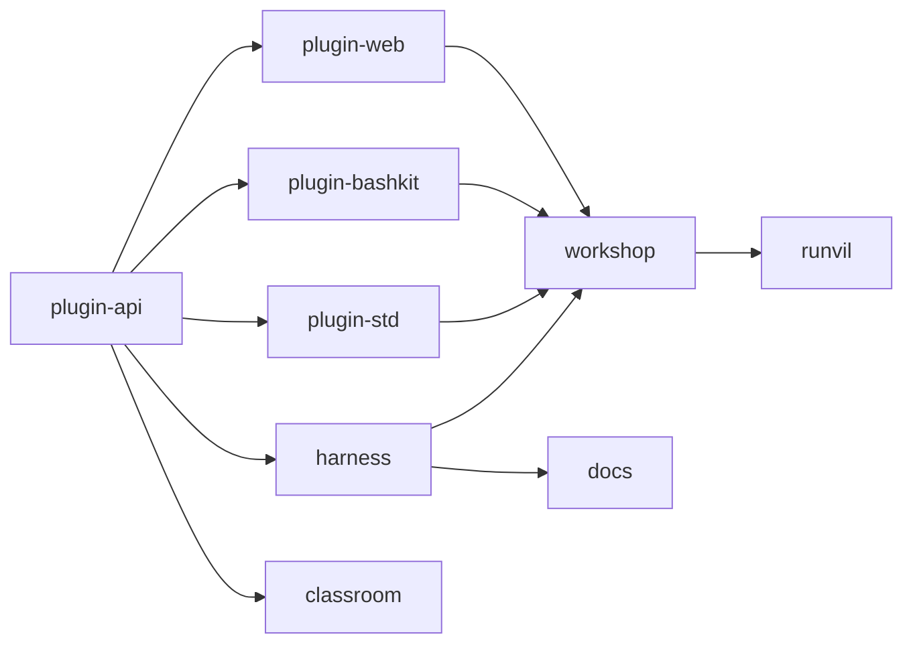

# Pack render verb

This is the part of the plan for contract 0.7 that concerns this repository. The contract, the Harness, and the Plugins merge first; this repository pins each of them at the commit that merge made, and the SDK at the contract commit.

## The idea in plain terms

- **Catalog tool.** A tool a Pack declares when a run starts, such as `fs/edit`. Lua can call it by id, a prompt offers it with `tools.offer("fs/edit")` or `tools.offer("fs")`, and its parameters are documented and fixed for the run.
- **Model-facing tool.** A tool that exists only in a render's answer, such as `fs/str_replace` for Anthropic models or `fs/apply_patch` for OpenAI models. Only the model can call it. Lua can't name it.
- **Render.** At a section entry's first `models.loop` round, the Harness asks each offered Pack: "here are the tools the section offered and here is the model, what should the model see?" The answer is frozen for that section entry.
- **The name-locked rule.** A tool name always means one parameter schema. A render may give a catalog tool another wire name and description, but different parameters need a different tool name. So a Plugin's `call` matches on the tool name it receives and keeps no memory of what it rendered.
- **What exists today.** The Engine and Harness already do all of this for Rust Packs (`Effect::Render`, the merge, the run log). The C contract stops at verb 6, so a library Pack always passes its tools through unchanged. Today's merge also lets a render rewrite a catalog tool's parameters.
- **What this plan adds.** The verb, the SDK method, the loader's use of it, and the name-locked check in the Engine's merge.

## The contract change

In runvil-plugin-api/crates/runvil-plugin-sys/src/lib.rs, verb 7 leaves the reserved list (8 stays reserved) and the version becomes 0.7:

```rust
pub const RV_PACK_RENDER: RvVerb = 7;

#[repr(C)]
pub struct RvPackRenderArgs {
    pub size: u32,
    pub reserved: u32,
    pub ctx: *mut c_void,
    pub entry: RvStr,              // the section entry, Lua's sys.id
    pub model: RvStr,              // JSON object of the model's facts
    pub offered: *const RvToolInfo, // the tools the section offered from this Pack, in one set
    pub offered_len: usize,
    pub refuse: unsafe extern "C" fn(ctx: *mut c_void, reason: RvStr) -> RvStatus,
    pub add_tool: unsafe extern "C" fn(ctx: *mut c_void, info: *const RvToolInfo) -> RvStatus,
}
```

- **Call shape.** `call->pack_run` is the instance, as for `RV_TOOL_CALL`. The Plugin calls `add_tool` once for each tool the model should see, in order, and returns `RV_OK`.
- **Statuses.**
  - `RV_ERR_UNSUPPORTED`: the Pack doesn't render, and the offered tools pass through.
  - `refuse`, at most once, with a reason of at most `RV_MAX_LINE` bytes, returns `RV_ERR_REFUSED`: the render failed. It has the same form as `refuse` in `RvPackNewArgs`.
  - Any other status, or a misuse, also fails the render. A failed render fails the round that asked for it.
- **Rules.** It returns promptly, with no I/O and no blocking, like `RV_PACK_NEW`. It may come on any thread, beside tool calls of the same instance, and never beside `RV_PACK_DELETE`. Everything it is lent is valid for the call only.
- **What each offered tool holds.** `name` is the tool's name without the Pack id. `wire_name` is empty when the Host derives it. `parameters` is the Host's own JSON text of the schema, which can differ in spacing and key order from the text the Plugin gave `RV_PACK_NEW`. `flags` are the catalog's.
- **Sets.** The Host sends the verb once for each set the section offered the Pack into, the Static Set and the Dynamic Set, so a section entry sends it once or twice. Both get the same `entry` and `model`.
- **Model facts as JSON.** Keys: `server`, `name`, `description`, `context`, `thinking` (`never`, `always`, `switchable`), and `provider` when the catalog names one. New facts become new keys, with no struct change. For a model outside the Host's catalog, `thinking` is `never`.
- **Names.** A returned name that matches an offered one is that catalog tool, and it keeps the offered parameters. Any other name is a model-facing tool, which takes the flags the render gives it. A returned name that is a catalog tool the section did not offer fails the round.
- **No change to `RV_TOOL_CALL`.** The tool name already says which schema the arguments follow.

## Repository order



Each repository pins the one before it by commit, so each wave waits for the previous wave's merge. The four repositories in wave 2 run in parallel.

**The contract commit.** Every repository that names the contract uses one commit id of `runvil-plugin-api`: the Harness, the three Plugins, and Workshop's SDK line. `runvil-plugin-sys` sets `links`, so Cargo refuses two commits of the contract in one build. The id is recorded once, after wave 1 merges. If `runvil-plugin-api` gets another commit after that, all five are pinned again.

## Wave 3: runvil-workshop

Two commits.

- **Commit 1, `Add the plan for the pin of contract 0.7`.** Workshop's part of this plan under `plan/`.
- **Commit 2, `Pin the Harness, the SDK, and the Plugins at contract 0.7`.** In runvil-workshop/Cargo.toml: the three Harness lines and the three Plugin lines, each `rev` read from that repository's `upstream/master`; the SDK line, with `rev` set to the contract commit; and the comment that says "version 0.6". Also `Cargo.lock`, and whatever `deny.toml` and the `harness_pin` check name.
- Verify with Workshop's `AGENTS.md` commands.
